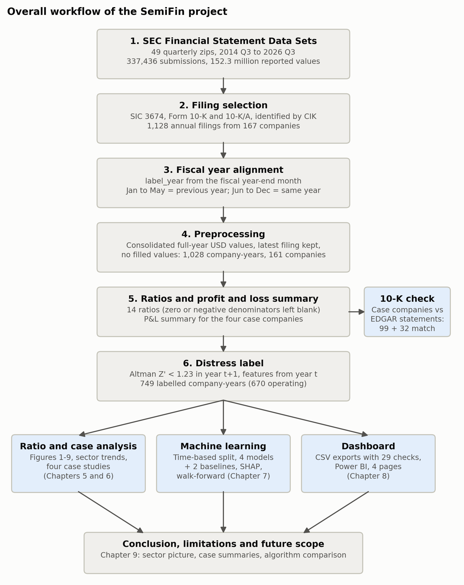

# SemiFin: Semiconductor Financial Health Analyzer

**Financial Ratio Analysis and Distress Prediction of Semiconductor Companies: A Comparative Study of Nvidia, AMD, Intel and Wolfspeed Using SEC XBRL Data**

FADS (Financial Analysis and Decision Science) mini project. It uses SEC filing data for U.S. semiconductor companies (SIC code 3674, label years 2015 to 2025) to analyse financial ratios and to predict financial distress one year ahead. Nvidia, AMD, Intel and Wolfspeed are the four case studies.

**Status: complete.** All nine phases are finished. The final report is [report/final/SemiFin_report.md](report/final/SemiFin_report.md), and the Power BI dashboard is [dashboard/SemiFin.pbix](dashboard/SemiFin.pbix).

## What the project does

1. **Data:** collects the annual 10-K statements of every SIC 3674 filer from the SEC Financial Statement Data Sets (49 quarterly files, 2014 Q3 to 2026 Q3).
2. **Cleaning:** aligns fiscal years to a common `label_year` and cleans the data into 1,028 company-years from 161 companies. No missing values are filled in.
3. **Ratios:** computes 14 financial ratios, plus a profit and loss summary for the four case companies. Case-company values were checked against their 10-K filings: 99 + 32 values matched.
4. **Distress label:** labels distress with the Altman Z' score. Z' below 1.23 in year t+1 counts as distressed, and the features come from year t.
5. **Models:** trains logistic regression, a decision tree, a random forest and XGBoost, using time-based splits. They are compared against two simple rules (baselines).
6. **Outputs:** presents the results in 14 report figures, a four-page Power BI dashboard and a full written report.



## Key results

- **Distress was common in the sector.** Each year, 28% to 47% of operating companies had a Z' below 1.23, with an average of 36.9%. Median profitability was thin and cyclical.
- **Nvidia grew.** Its revenue rose from USD 5.0 bn to 215.9 bn, and the model never rated its risk above 18%.
- **AMD recovered.** It went from negative equity in 2015 to a Z' above 1.23 from 2020.
- **Intel declined.** Its gross margin fell from 63% to 33%, it made a net loss of USD 18.8 bn in 2024, and its Z' fell below 1.23 from 2023.
- **Wolfspeed became distressed.** It made a loss every year and filed for Chapter 11 on 30 June 2025. Its current ratio stayed above 3 until 2024, so liquidity gave no warning.
- **Best model: the random forest.** On the test years it scored F1 0.779, ROC-AUC 0.895 and PR-AUC 0.883.
  - It is far better than the "current ratio < 1" rule (F1 0.138).
  - It is not better than simply carrying this year's Z' forward (F1 0.846).
  - Its real value is early warning, but it caught only 3 of the 10 companies that went from healthy to distressed.
- **The most useful warning signs** were profitability, interest coverage and leverage, not liquidity.

## Deliverables

| Item | Location |
| --- | --- |
| Final report | [report/final/SemiFin_report.md](report/final/SemiFin_report.md) |
| Report figures 1–14 and captions | [figures/](figures/), [figures/captions.md](figures/captions.md) |
| Power BI dashboard | [dashboard/SemiFin.pbix](dashboard/SemiFin.pbix), [screenshots](dashboard/screenshots/) |
| Dashboard build guide and theme | [dashboard/BUILD_GUIDE.md](dashboard/BUILD_GUIDE.md), [dashboard/semifin_theme.json](dashboard/semifin_theme.json) |
| Dashboard data (12 CSVs) | [dashboard/exports/](dashboard/exports/) |
| Processed tables (ratios, labels, predictions, checks) | [data/processed/](data/processed/) |
| Data decisions log | [docs/data_log.md](docs/data_log.md) |
| References | [report/drafts/references.md](report/drafts/references.md) |

## Tech stack

Python 3.12 (pandas, NumPy, scikit-learn, XGBoost, imbalanced-learn, SHAP, matplotlib, seaborn), Jupyter, Power BI Desktop, Git. Exact package versions are in [requirements.txt](requirements.txt).

## Setup

```bash
python -m venv .venv
# Windows:   .venv\Scripts\activate
# macOS/Linux: source .venv/bin/activate
pip install -r requirements.txt
```

## Getting the data (manual download)

The raw data is not stored in this repository.

1. Download the **SEC Financial Statement Data Sets** quarterly zips (sec.gov, Data & Research) for 2014 Q3 to 2026 Q3, for example `2024q1.zip`.
2. Put the zips, unchanged, into `data/raw/`. The code reads this folder and never writes to it.
3. Set the environment variable `SEC_USER_AGENT` to `"Your Name your@email"`. Notebooks 02, 03 and 07 use it to download SEC company facts and 10-K statement pages for the four case companies, and they skip the download if the files are already cached.

## Running the analysis

Run the notebooks in order; each one reads the outputs of the previous one.

| Notebook | Phase |
| --- | --- |
| `notebooks/01_data_collection.ipynb` | 1: Data collection |
| `notebooks/02_preprocessing.ipynb` | 2: Preprocessing |
| `notebooks/03_ratios_and_pnl.ipynb` | 3: Ratios and profit and loss, 10-K check |
| `notebooks/04_distress_label.ipynb` | 4: Distress label (Altman Z') |
| `notebooks/05_modelling.ipynb` | 5: Machine learning |
| `notebooks/06_figures_and_exports.ipynb` | 6 and 7: Report figures and dashboard CSVs |
| `notebooks/07_case_studies.ipynb` | 8: Case study observations |
| `notebooks/08_conclusion.ipynb` | 9: Conclusion and algorithm comparison |

To redraw Figure 14 (the workflow diagram), run `python -m src.workflow_figure`. Random seeds are fixed in `src/config.py`.

## Folder layout

```
data/raw         untouched SEC zips (not committed)
data/interim     intermediate tables (not committed)
data/processed   clean, ratio, label, prediction and verification tables
notebooks/       one notebook per phase (01-08)
src/             shared code (config, loading, preprocessing, ratios, labels,
                 models, plots, exports, case studies, 10-K verification)
figures/         report figures 1-14 with captions
dashboard/       Power BI file, theme, build guide, CSV exports, screenshots
report/          drafts and the final report
docs/            project guide and data log
```
