# Financial Ratio Analysis and Distress Prediction of Semiconductor Companies

## A Comparative Study of Nvidia, AMD, Intel and Wolfspeed Using SEC XBRL Data

**SemiFin: Semiconductor Financial Health Analyzer**

Mini project report, Financial Analysis and Decision Science (FADS)

| | |
| --- | --- |
| Submitted by | [Name], [Roll number] |
| Guide / subject teacher | [Name of teacher] |
| Department | [Department] |
| College | [College name] |
| Academic year | 2026–27 |

---

## Certificate

[Insert the college certificate template here.]

## Declaration

[Insert the college declaration template here.]

## Acknowledgement

[Short thanks to the subject teacher, the department and team members.]

---

## Abstract

Semiconductor companies share one industry but follow very different financial paths, and a single ratio rarely shows which firms are healthy. This project analyses the financial health of U.S. semiconductor companies (SIC code 3674) using annual 10-K data from the SEC Financial Statement Data Sets for fiscal years 2015 to 2025. After cleaning, the dataset contains 1,028 company-years from 161 companies. Fourteen liquidity, leverage, profitability, efficiency and growth ratios and a profit and loss summary were computed. Four contrasting companies, Nvidia (growth), AMD (turnaround), Intel (decline) and Wolfspeed (distress), were studied in detail and their values checked against their 10-K filings. Financial distress was defined as an Altman Z' score below 1.23. Logistic regression, a decision tree, a random forest and XGBoost were trained to predict distress one year ahead, using time-based splits, and were compared with two simple baselines. Distress was common: between 28% and 47% of operating companies were distressed each year. The random forest performed best (test F1 0.779, ROC-AUC 0.895), far above a current-ratio rule (F1 0.138), but below a persistence baseline that carries forward this year's Z' (F1 0.846). Profitability and interest coverage warned of distress earlier than liquidity; Wolfspeed's current ratio stayed above 3 until the year it filed for Chapter 11. The results are presented in a Power BI dashboard.

**Keywords:** financial ratio analysis, Altman Z-score, financial distress prediction, machine learning, semiconductors, XBRL.

---

## Table of contents

1. Introduction
2. Literature review
3. Dataset description
4. Methodology
5. Exploratory and ratio analysis
6. Case studies
7. Machine learning results
8. Dashboard
9. Conclusion, limitations and future scope

References
Appendix A: Data dictionary
Appendix B: Preprocessing log
Appendix C: Code and repository
Appendix D: Additional tables

## List of figures

| No. | Title |
| --- | --- |
| 1 | Number of SIC 3674 companies per label year |
| 2 | Revenue of the case companies, 2015–2025 (log scale) |
| 3 | Net income of the case companies, 2015–2025 |
| 4 | Current ratio and quick ratio |
| 5 | Debt-to-equity and interest coverage |
| 6 | Gross, operating and net margin |
| 7 | Return on assets and return on equity |
| 8 | Altman Z' score with the 1.23 and 2.90 cutoffs |
| 9 | Spearman correlation between the ratios |
| 10 | Model comparison on the test years |
| 11 | ROC curves of all models and baselines |
| 12 | Feature importance of the random forest |
| 13 | Walk-forward predicted probability of distress, case companies |
| 14 | Overall workflow of the project |
| 15–19 | Dashboard pages (sector overview, company drill-down ×2, four-case comparison, model results) |

## List of tables

| No. | Title |
| --- | --- |
| 3.1 | Case companies and their identifiers |
| 3.2 | Filing selection and cleaning steps |
| 4.1 | Fiscal year alignment of the case companies |
| 4.2 | Ratio definitions |
| 4.3 | Treatment of zero and negative denominators |
| 4.4 | Altman Z' components and zones |
| 4.5 | Models, settings searched and settings chosen |
| 5.1 | Sector indicators by year (operating companies) |
| 5.2 | Distribution of the main ratios (operating companies) |
| 5.3 | Profit and loss summary of the case companies |
| 6.1 | Hypothesis check for the case companies |
| 6.2 | First year each warning sign appeared |
| 6.3 | Walk-forward predictions against outcomes |
| 6.4 | The current-ratio rule as a warning signal |
| 6.5 | Revenue growth and next-year distress |
| 7.1 | Class balance by feature year |
| 7.2 | Model comparison on the test years |
| 7.3 | Confusion matrices on the test years |
| 7.4 | Early-warning cases on the test years |
| 8.1 | Dashboard data files |

---

# Chapter 1. Introduction

## 1.1 Background

Financial ratio analysis turns the figures in a company's financial statements into comparable measures of liquidity, leverage, profitability, efficiency and growth. Because ratios scale out company size, they allow a small chip designer to be compared with a global manufacturer, and a company to be compared with its own past. Since the 1960s, researchers have also used ratios to predict business failure, starting with univariate comparisons of failed and surviving firms [7] and the multivariate Z-score [5].

The semiconductor industry is a demanding setting for this kind of analysis:
- **It is cyclical.** Demand rises and falls with personal computers, smartphones, data centres and cars.
- **It is capital-intensive.** Manufacturing plants cost billions and take years to pay back.
- **It has extreme differences in scale.** In 2025 Nvidia's revenue was about 285 times Wolfspeed's.

Firms in the same industry can therefore be growing very fast, recovering, declining or in distress at the same time.

## 1.2 Motivation

Investors, lenders and analysts need early signs of financial trouble. Public companies in the United States file their statements with the SEC in machine-readable XBRL form, and the SEC publishes these values as quarterly data sets. This makes it possible to build a complete, documented ratio dataset for a whole industry from primary data, and to test whether machine learning can flag distress earlier than simple rules.

## 1.3 Problem statement

To analyse the financial performance of U.S. semiconductor companies using ratio analysis on SEC XBRL data, and to build and compare machine learning models that classify companies as financially healthy or distressed, using Nvidia, AMD, Intel and Wolfspeed as comparative case studies.

## 1.4 Objectives

1. Build a clean, documented dataset of annual financial statements for SIC 3674 filers.
2. Compute liquidity, leverage, profitability, efficiency and growth ratios, plus a profit and loss summary for each case company.
3. Analyse and visualise the historical trends of the four case companies.
4. Define distress with a clear, defensible rule and build at least three models to predict it one year ahead.
5. Compare the models on suitable metrics and interpret which ratios drive the predictions.
6. Present the results in a dashboard and a written conclusion.

## 1.5 Research questions

1. Which ratios best separate healthy from distressed semiconductor companies?
2. How do the financial trajectories of Nvidia, AMD, Intel and Wolfspeed differ, and do the ratios show the trouble early?
3. Which model predicts next-year distress best, and is the gain over a simple baseline worth the added complexity?

## 1.6 Scope

- **Companies:** U.S. SEC registrants with Standard Industrial Classification (SIC) code 3674, Semiconductors and Related Devices, that file annual reports on Form 10-K.
- **Years:** label years 2015 to 2025, with 2014 used only as the base year for growth ratios.
- **Case companies:** Nvidia, AMD, Intel and Wolfspeed (formerly Cree) are analysed in detail. All eligible companies are used to train the models.
- **Excluded:** foreign companies filing Form 20-F, quarterly data and market prices.

---

# Chapter 2. Literature review

## 2.1 Ratio-based failure prediction

**Beaver (1966)** compared financial ratios of failed and non-failed firms one at a time and showed that individual ratios, especially cash flow to total debt, differ between the two groups several years before failure [7]. This univariate approach established that ratios carry information about future failure, but it judges one ratio at a time and can give conflicting signals.

**Altman (1968)** combined five ratios into one score with multiple discriminant analysis, using a sample of U.S. manufacturing firms [5]. The resulting Z-score weights working capital, retained earnings, operating income (EBIT), the market value of equity and sales, each scaled by total assets or total liabilities. Because the original model needs the market value of equity, Altman later published a revised version for firms without market prices, Z', which uses the book value of equity and re-estimated coefficients [6]. Z' is used in this project because the SEC statement data contains no share prices. Its coefficients and cutoffs (1.23 and 2.90) are taken from secondary sources that agree on them [11–14].

**Ohlson (1980)** replaced discriminant analysis with logistic regression (logit), which gives a probability of failure and does not need the distributional assumptions of discriminant analysis [8]. **Zmijewski (1984)** showed that the way failed and healthy firms are sampled can bias distress models, in particular when failed firms are over-represented relative to their real frequency [30]. **Shumway (2001)** argued that single-period models ignore how a firm's risk changes over time, proposed a discrete-time hazard model, and found that about half of the accounting ratios used in earlier models were not statistically significant, while market-based variables were strongly related to bankruptcy [31].

## 2.2 Machine learning for distress prediction

Tree-based ensemble methods became common in credit and distress modelling because they capture non-linear effects and interactions between ratios without them being specified in advance. A **random forest** averages many decision trees, each grown on a bootstrap sample with a random subset of features, which reduces the variance of a single tree [20]. **Gradient boosting**, in the scalable XGBoost implementation, builds trees in sequence, each correcting the errors of the previous ones [19]. **Barboza, Kimura and Altman (2017)** compared machine learning methods, including support vector machines, bagging, boosting and random forests, with discriminant analysis and logistic regression for bankruptcy prediction, and found the ensemble methods more accurate than the traditional models [32]. To interpret such models, **SHAP** values attribute each prediction to the input features in a way that is consistent across models [21].

## 2.3 Gap addressed by this project

Most distress studies use mixed-industry samples of large databases, and many evaluate models with random train/test splits that let information from later years leak into training. This project:
- **Focuses on one industry,** semiconductors, using primary SEC XBRL data that is fully documented from download to ratio.
- **Uses only time-based splits** and fits every preprocessing step on training years only.
- **Compares the models with simple baselines,** including carrying forward the current Z' score, so the added value of machine learning is measured rather than assumed.
- **Ties the sector-wide models to four contrasting case companies,** whose computed values were checked against their 10-K filings.

---

# Chapter 3. Dataset description

## 3.1 Source

The data comes from the SEC **Financial Statement Data Sets** [1]. These are quarterly zip files containing the numeric XBRL data of every filing submitted in that quarter. Each zip holds four tab-separated files, whose fields were checked against the `readme.htm` in every quarter [2]:

| File | Content | Key fields used |
| --- | --- | --- |
| `sub` | One row per filing (submission) | `adsh` (accession number), `cik`, `name`, `sic`, `form`, `period`, `filed` |
| `num` | One row per reported number | `adsh`, `tag`, `ddate`, `qtrs`, `uom`, `segments`, `coreg`, `value` |
| `tag` | Definitions of the XBRL tags | tag name and label |
| `pre` | How tags appear in the statements | statement and line order |

The 49 quarterly files from 2014 Q3 to 2026 Q3 (about 4.3 GB) were downloaded. All passed an integrity test, and their headers were identical in every quarter. In total, 337,436 `sub` rows and 152,323,720 `num` rows were parsed, with no rows lost.

## 3.2 Selection

Filings were kept if the company's SIC code was 3674 and the form was 10-K or 10-K/A (amended). Transition-period reports (10-KT, 4 filings) and foreign issuers' annual reports (20-F/40-F, 266 filings) were excluded. This left 1,128 annual filings from 167 companies. Companies are identified by their **CIK** (Central Index Key), never by name, because names change: Wolfspeed was named Cree until late 2021.

**Table 3.1. Case companies and their identifiers (verified in the `sub` file)**

| Company | CIK | Fiscal year ends | Role in the study |
| --- | --- | --- | --- |
| Nvidia | 1045810 | Late January | Main case: growth |
| AMD | 2488 | Late December | Turnaround |
| Intel | 50863 | Late December | Decline |
| Wolfspeed (formerly Cree) | 895419 | Late June | Distress |

All four had SIC 3674 in every filing and exactly one 10-K per label year from 2014 to 2025.

## 3.3 Size of the final dataset

**Table 3.2. Filing selection and cleaning steps**

| Step | Company-years | Companies | Removed |
| --- | --- | --- | --- |
| Annual filings of SIC 3674 companies (all label years) | 1,128 | 167 | – |
| Label years 2014 to 2025 only | 1,114 | 167 | 14 |
| Latest filing per company and fiscal year (amendments deduplicated) | 1,087 | 167 | 27 |
| Filings with USD statement values | 1,085 | 166 | 2 |
| After dropping rows missing a core item | **1,028** | **161** | 57 |

The final table has one row per company per label year, with 80 to 103 companies in each year. The analysis years 2015 to 2025 contain 925 company-years from 146 companies. Of these, 106 company-years belong to very small companies with revenue below USD 10 million; they are kept for description but excluded from modelling (Section 4.7). Figure 1 shows the number of companies per year.

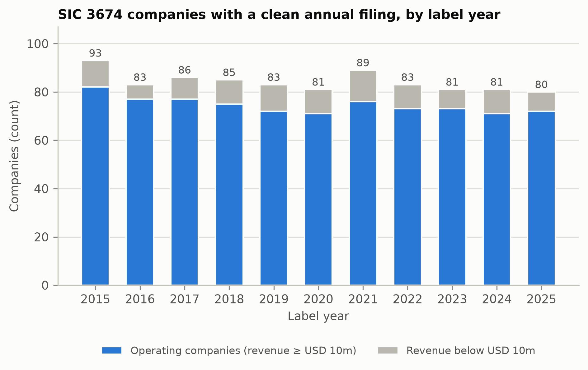

**Figure 1. Number of SIC 3674 companies per label year.** The sample shrinks from 93 companies in 2015 to 80 in 2025.

---

# Chapter 4. Methodology

## 4.1 Workflow

**Figure 14. Overall workflow of the project.** SEC filings were selected, aligned to label years and cleaned into 1,028 company-years; ratios and the Altman Z' label (year t+1) then feed three strands: ratio and case analysis (Chapters 5–6), machine learning (Chapter 7) and the Power BI dashboard (Chapter 8). Case-company values were checked against their 10-K filings (99 + 32 values matched).

Every cleaning decision was recorded on the day it was made in a data log (`docs/data_log.md`, summarised in Appendix B).

## 4.2 Fiscal year alignment

Companies end their fiscal years in different months, so each filing was given a `label_year` using the Compustat convention [9]: a fiscal year ending between January and May is labelled with the previous calendar year, and one ending between June and December with the year in which it ends. The rule needs only the fiscal year-end date and is applied to every company in the same way. The original fiscal year-end date is kept in every table.

**Table 4.1. Fiscal year alignment of the case companies**

| Company | Fiscal year ends | Example period date in the SEC data | Label year |
| --- | --- | --- | --- |
| Nvidia | Late January | 31 January 2025 | 2024 |
| AMD | Late December | 31 December 2024 | 2024 |
| Intel | Late December | 31 December 2024 | 2024 |
| Wolfspeed | Late June | 30 June 2024 | 2024 |

The SEC data rounds each period date to the month-end [2]; the month is all the rule needs.

Wolfspeed remains about six months out of step with the other three, because a June year-end splits evenly across two calendar years. This is a stated limitation (Chapter 9).

## 4.3 Preprocessing

1. **Value filter.** From the `num` file, only the filing's own consolidated, full-year figures in U.S. dollars were kept. That means the date (`ddate`) equal to the filing's own fiscal year-end, `uom` = USD, no co-registrant and no segment breakdown. Balance sheet items use `qtrs` = 0 and income items `qtrs` = 4. This kept 99,251 of 474,830 values.
2. **Amendments.** Where a company filed more than once for the same fiscal year, the latest filing was kept.
3. **Tag priority.** Companies use different XBRL tags for the same item, and tags changed over time. For example, revenue moved to `RevenueFromContractWithCustomerExcludingAssessedTax` when the new revenue standard (ASC 606) took effect in 2018 [10]. Each item was taken from an ordered list of tags, and the tag used was saved.
4. **Interest expense.** Interest disclosed only in the notes was filled for the case companies from the same 10-K through the SEC company facts API [3]. Otherwise, cash interest paid was used as a flagged substitute. Interest was set to zero only if the company reported no debt.
5. **Derived items.**
   - **Total liabilities.** It was derived as total liabilities and equity minus temporary equity minus total equity where it was not reported. AMD, Intel and Wolfspeed never report a total.
   - **Gross profit.** Revenue minus cost of revenue was used where gross profit was not reported.
   - **Inventory.** Set to zero only for companies that never report any.

   Every such value is flagged.
6. **Missing core items.** Company-years missing total assets, equity, total liabilities, revenue or net income were dropped (57 rows, none of them case companies). No value was ever filled with a mean or an invented number.
7. **Units.** All money values were converted to USD millions.
8. **Flags, not drops.** Very small companies (revenue below USD 10 million) and sanity-check failures (balance sheet not adding up within 1%, or a jump of more than 10 times in one year) were flagged, not removed.

## 4.4 Ratios

**Table 4.2. Ratio definitions**

| Category | Ratio | Formula |
| --- | --- | --- |
| Liquidity | Current ratio | Current assets ÷ Current liabilities |
| Liquidity | Quick ratio | (Current assets − Inventory) ÷ Current liabilities |
| Liquidity | Cash ratio | Cash and cash equivalents ÷ Current liabilities |
| Leverage | Debt-to-equity | Total liabilities ÷ Total stockholders' equity |
| Leverage | Debt ratio | Total liabilities ÷ Total assets |
| Leverage | Interest coverage | Operating income ÷ Interest expense |
| Profitability | Gross margin | Gross profit ÷ Revenue |
| Profitability | Operating margin | Operating income ÷ Revenue |
| Profitability | Net margin | Net income ÷ Revenue |
| Profitability | Return on assets (ROA) | Net income ÷ Total assets |
| Profitability | Return on equity (ROE) | Net income ÷ Total stockholders' equity |
| Efficiency | Asset turnover | Revenue ÷ Total assets |
| Growth | Revenue growth | Revenue this year ÷ Revenue last year − 1 |
| Growth | Net income growth | (Net income this year − last year) ÷ \|Net income last year\| |
| Size | Log total assets | ln(Total assets, USD millions), used only as a model input |

**Table 4.3. Treatment of zero and negative denominators**

| Situation | Treatment |
| --- | --- |
| Current liabilities missing or ≤ 0 | Liquidity ratios left blank |
| Equity ≤ 0 | Debt-to-equity and ROE blank; flag `negative_equity` |
| Interest expense = 0 (no debt) | Interest coverage blank; flag `no_interest_expense` |
| Interest expense from cash interest paid | Coverage computed; flag `coverage_uses_proxy` |
| Revenue ≤ 0 | Margins blank |
| Previous label year missing, or last year's revenue ≤ 0 / net income = 0 | Growth ratios blank |

A negative denominator would reverse the meaning of a ratio (for example, a loss divided by negative equity would look like a positive return), so such ratios were left blank rather than computed.

A **profit and loss summary** was built for the case companies:
- Reported gross profit and operating income were used as filed.
- Operating expenses, other non-operating items and discontinued operations were derived so that each statement adds up.
- Each year was labelled "Profit" or "Loss" from net income, with the year-on-year change.

**Verification.** For each case company in 2017 and 2024 (plus Wolfspeed 2025), eleven computed items were compared with the 10-K statements rendered on EDGAR [4]. All 99 values matched. In the case study phase, capital expenditure, share buybacks and goodwill were also checked for 2017, 2022 and 2024, and all 32 values matched [28].

## 4.5 Distress label

Distress was defined with the Altman Z' score for firms without market prices [6], computed from book values:

Z' = 0.717 X1 + 0.847 X2 + 3.107 X3 + 0.420 X4 + 0.998 X5

**Table 4.4. Altman Z' components and zones**

| Term | Formula | | Z' range | Zone | Label |
| --- | --- | --- | --- | --- | --- |
| X1 | (Current assets − Current liabilities) ÷ Total assets | | below 1.23 | Distress | 1 |
| X2 | Retained earnings ÷ Total assets | | 1.23 to 2.90 | Grey | 0 |
| X3 | Operating income ÷ Total assets | | 2.90 and above | Safe | 0 |
| X4 | Book equity ÷ Total liabilities | | | | |
| X5 | Revenue ÷ Total assets | | | | |

- **Grey zone.** Only scores below 1.23 count as distressed; the grey zone is treated as healthy.
- **Missing inputs.** Z' was left blank if any input was missing (45 of 1,028 company-years).
- **Time shift.** The features come from year t and the label from year t+1, attached only when t+1 is the company's next consecutive label year. This makes the task an early warning rather than a description of the present.
- **No overlap with inputs.** Z' and X1–X5 were never used as model inputs.
- **Robustness label.** As a second definition, a company-year was labelled distressed if it had a net loss, interest coverage below 1.5 and a current ratio below 1 in the same year.

## 4.6 Models

Four classifiers were trained on 18 features: the 15 ratios of Table 4.2 (including log total assets) and three flags (negative equity, no interest expense, coverage from a proxy).

**Table 4.5. Models, settings searched and settings chosen**

| Model | Settings searched | Chosen setting | Decision threshold |
| --- | --- | --- | --- |
| Logistic regression (baseline model) | C ∈ {0.01, 0.1, 1, 10} | C = 1 | 0.770 |
| Decision tree | depth 2–5 × min leaf {5, 10, 20} | depth 4, min leaf 10 | 0.933 |
| Random forest (500 trees) | depth {3, 5, 8, none} × min leaf {1, 5, 10} | depth 8, min leaf 1 | 0.494 |
| XGBoost | trees {200, 500} × depth 2–4 × learning rate {0.03, 0.1} | 200 trees, depth 3, rate 0.03 | 0.721 |

Two non-learning **baselines** were included:
- **Current ratio rule:** predict distressed if the current ratio is below 1.
- **Persistence:** predict distressed next year if Z' is below 1.23 this year.

## 4.7 Training and evaluation design

- **Modelling sample.** Companies with revenue below USD 10 million were excluded from training and testing (79 labelled rows). They are 89% distressed and would inflate the scores. That leaves 670 labelled company-years.
- **Time-based split by feature year:**
  - train: 2015–2020 (397 rows, 38% distressed)
  - validation: 2021–2022 (139 rows, 31%)
  - test: 2023–2024 (134 rows, 40%)

  No random split was used.
- **Preprocessing fitted on training years only:**
  - ratios capped at the 1st and 99th percentiles (winsorising)
  - blank ratios filled with the training median plus a "was missing" indicator; XGBoost handles blanks itself
  - standard scaling for logistic regression
- **Imbalance.** Class weights were used ("balanced", or `scale_pos_weight` for XGBoost); no resampling.
- **Selection and final fit.** Settings were chosen by validation PR-AUC, and each model's threshold by the best validation F1. Each model was then refitted on 2015–2022 and evaluated once on the test years.
- **Metrics.** Precision, recall and F1 for the distressed class, ROC-AUC, PR-AUC and the confusion matrix. Accuracy is not reported on its own.
- **Interpretation.** Permutation importance and SHAP values [21, 22].
- **Walk-forward.** For each feature year from 2018 to 2025, a model was trained only on earlier years, so every company-year received an out-of-sample probability.
- **Random seed.** 42 throughout.

## 4.8 Tools

- **Python 3.12:** pandas, NumPy, scikit-learn [18], XGBoost [19], SHAP [21], matplotlib [23] and Beautiful Soup [15], in Jupyter notebooks with one notebook per phase.
- **Power BI Desktop** [25] for the dashboard.
- **Git** for version control (Appendix C).

---

# Chapter 5. Exploratory and ratio analysis

## 5.1 Sector trends

Table 5.1 summarises the sector each year for operating companies (revenue of at least USD 10 million).

**Table 5.1. Sector indicators by year (operating companies)**

| Year | Companies | Z' < 1.23 (%) | Median current ratio | Median net margin (%) | Loss-making (%) |
| --- | --- | --- | --- | --- | --- |
| 2015 | 82 | 28.2 | 3.57 | 2.1 | 43.9 |
| 2016 | 77 | 46.6 | 3.80 | 2.0 | 42.9 |
| 2017 | 77 | 39.7 | 3.65 | 6.2 | 41.6 |
| 2018 | 75 | 34.2 | 3.39 | 3.3 | 42.7 |
| 2019 | 72 | 41.4 | 2.82 | 2.0 | 41.7 |
| 2020 | 71 | 35.3 | 3.15 | 6.5 | 33.8 |
| 2021 | 76 | 37.0 | 3.04 | 8.5 | 32.9 |
| 2022 | 73 | 30.6 | 2.92 | 7.7 | 37.0 |
| 2023 | 73 | 33.3 | 3.21 | 1.2 | 49.3 |
| 2024 | 71 | 44.3 | 3.12 | −2.5 | 54.9 |
| 2025 | 72 | 35.7 | 2.69 | 1.2 | 47.2 |

Distress was common throughout: on average 36.9% of operating companies had Z' below 1.23, with peaks in 2016 and 2024 and no steady trend. Profitability was thin and cyclical. The median net margin was best in 2021 (8.5%) and negative in 2024 (−2.5%), when 54.9% of operating companies made a loss. The median current ratio declined slowly from 3.57 to 2.69.

## 5.2 Ratio distributions

**Table 5.2. Distribution of the main ratios (operating companies, 2015–2025)**

| Ratio | Company-years | 25th percentile | Median | 75th percentile |
| --- | --- | --- | --- | --- |
| Current ratio | 819 | 2.10 | 3.19 | 5.31 |
| Quick ratio | 805 | 1.51 | 2.43 | 4.33 |
| Debt-to-equity | 791 | 0.26 | 0.59 | 1.13 |
| Debt ratio | 819 | 0.21 | 0.38 | 0.54 |
| Interest coverage | 623 | −5.59 | 3.27 | 16.31 |
| Gross margin | 811 | 30.2% | 45.6% | 56.9% |
| Operating margin | 815 | −13.0% | 5.3% | 16.2% |
| Net margin | 819 | −13.5% | 3.2% | 15.0% |
| ROA | 819 | −7.5% | 2.0% | 9.6% |
| ROE | 791 | −10.5% | 4.5% | 15.7% |
| Asset turnover | 819 | 0.46 | 0.62 | 0.82 |
| Revenue growth | 773 | −6.0% | 6.3% | 23.5% |

The typical semiconductor company held plenty of liquidity (median current ratio 3.19) and little leverage (median debt ratio 0.38), but had thin profits: a quarter of company-years had an operating margin below −13%. This combination explains a finding of Chapter 6: liquidity ratios rarely signal distress in this sector, because distressed companies often still hold cash raised from investors. Blank values (for example, interest coverage for companies without debt) explain the different counts.

## 5.3 Correlation between ratios

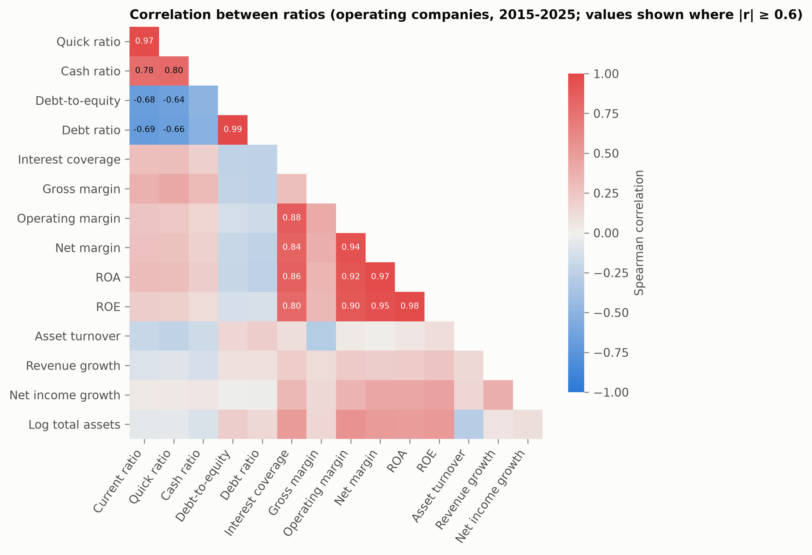

**Figure 9. Spearman correlation between the 15 ratios (operating companies, 2015–2025, 819 company-years).** Spearman rank correlation [24] was used because the ratios have extreme values. The strongest correlations are debt ratio with debt-to-equity (0.99), ROE with ROA (0.98), ROA with net margin (0.97), quick ratio with current ratio (0.97) and ROE with net margin (0.95). These groups carry overlapping information. Tree models are not harmed by this, but individual logistic regression coefficients of related ratios should not be read one by one.

## 5.4 Profit and loss summary of the case companies

**Table 5.3. Profit and loss summary of the case companies (USD millions)**

| Company | Year | Revenue | Gross profit | Operating income | Interest expense | Income tax | Net income | Result |
| --- | --- | --- | --- | --- | --- | --- | --- | --- |
| Nvidia | 2015 | 5,010 | 2,811 | 747 | 47 | 129 | 614 | Profit |
| Nvidia | 2020 | 16,675 | 10,396 | 4,532 | 184 | 77 | 4,332 | Profit |
| Nvidia | 2025 | 215,938 | 153,463 | 130,387 | 259 | 21,383 | 120,067 | Profit |
| AMD | 2015 | 3,991 | 1,080 | −481 | 160 | 14 | −660 | Loss |
| AMD | 2020 | 9,763 | 4,347 | 1,369 | 47 | −1,210 | 2,490 | Profit |
| AMD | 2025 | 34,639 | 17,152 | 3,694 | 131 | −103 | 4,335 | Profit |
| Intel | 2015 | 55,355 | 34,679 | 14,002 | 337 | 2,792 | 11,420 | Profit |
| Intel | 2020 | 77,867 | 43,612 | 23,678 | 629 | 4,179 | 20,899 | Profit |
| Intel | 2025 | 52,853 | 18,375 | −2,214 | 1,091 | 1,531 | −267 | Loss |
| Wolfspeed | 2015 | 1,633 | 475 | −73 | 1 | −19 | −64 | Loss |
| Wolfspeed | 2020 | 904 | 248 | −209 | 35 | 0 | −192 | Loss |
| Wolfspeed | 2025 | 758 | −122 | −1,329 | 315 | −10 | −1,609 | Loss |

Over 2015 to 2025, Nvidia made a profit in all 11 years, AMD made losses in 2 years (2015–2016), Intel in 2 years (2024–2025) and Wolfspeed in all 11. Negative income tax values are tax benefits; AMD's 2020 tax benefit of USD 1,210 million lifted its net income above its operating income. Wolfspeed's 2015 interest uses cash interest paid as a substitute. The full table for every year is in `data/processed/pnl_case_companies.csv`.

---

# Chapter 6. Case studies

The guide's expected pattern for each company was treated as a hypothesis and tested against the computed numbers. Table 6.1 (Appendix D) gives the full check: of 17 hypotheses, 12 were supported, 3 partly supported and 2 contradicted.

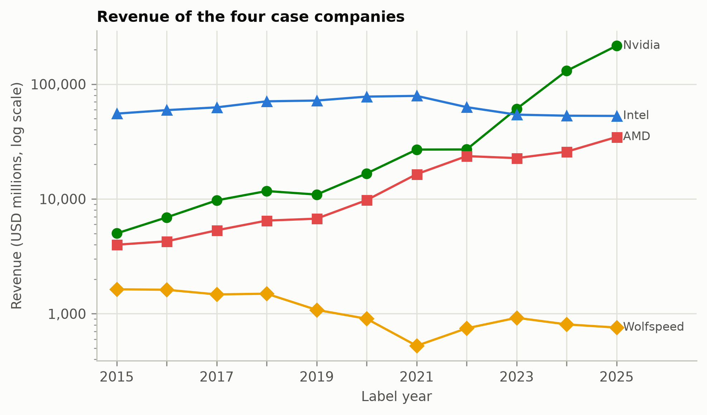

**Figure 2. Revenue, 2015 to 2025 (log scale).** Nvidia's revenue grew from USD 5,010m to 215,938m and overtook Intel's in 2023. Intel fell from a peak of USD 79,024m (2021) to 52,853m, and Wolfspeed shrank from USD 1,633m to 758m.

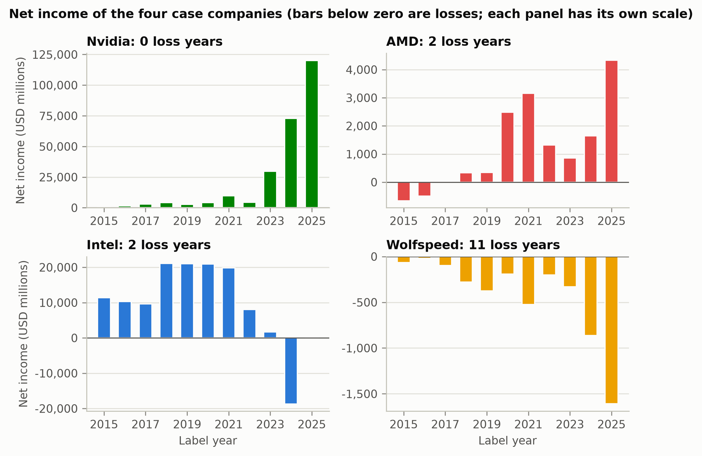

**Figure 3. Net income, 2015 to 2025 (separate scales).** Nvidia was profitable in every year. AMD made losses in 2015 and 2016. Intel turned to losses in 2024 and 2025 (USD −18,756m in 2024). Wolfspeed lost money in every year, reaching USD −1,609m in 2025.

## 6.1 Nvidia: growth (main case)

Nvidia was the clear growth case:
- **Growth.** Revenue rose from USD 5,010m in 2015 to 215,938m in 2025 (Figure 2), operating margin from 15% to 62% in 2024 (Figure 6), and ROE from 14% to 92% in 2024 (Figure 7).
- **Not a smooth rise.** Operating margin dipped to 26% in 2019 and 16% in 2022. The step change came in 2023, when revenue reached USD 60,922m and operating margin 54%.
- **Liquidity stayed strong.** The current ratio stayed between 2.57 and 8.03 in every year (Figure 4).

**Contradiction: Z'.** The expectation that Nvidia's Z' would stay far above 2.90 was not met. Nvidia was in the grey zone in 2015, 2020, 2021 and 2022, with a low of 1.96 in 2022 (Figure 8). Breaking Z' into its five weighted parts shows two causes, neither of them financial weakness:
- **Low asset turnover.** Revenue / total assets (X5) stayed below 1 until 2024.
- **Falling retained earnings.** They fell while the company was profitable, because Nvidia retired USD 12,026m of treasury stock (shares bought back in earlier years) against retained earnings in 2021, and charged buybacks of USD 10,039m there in 2022. The retained-earnings term fell from 0.80 (2018) to 0.21 (2022).

The book-value Z' therefore understates the health of a cash-rich firm that returns capital through buybacks.

**ROE and buybacks: partly supported.** By the DuPont decomposition [29], Nvidia's 2024 ROE of 0.92 equals net margin 0.56 × asset turnover 1.17 × equity multiplier 1.41. The equity multiplier (assets / equity) stayed between 1.31 and 1.86, so the high ROE came from profit, not from a thin equity base. Buybacks were large (USD 33,706m in 2024, 46% of net income), but equity still grew from USD 42,978m to 79,327m.

**Model.** The walk-forward probability of distress stayed between 7% and 17% and was correct (healthy) in every year from 2018 to 2024 (Figure 13).

## 6.2 AMD: turnaround

AMD matched the turnaround hypothesis:
- **Weak start.** It lost money in 2015 and 2016 (USD −660m and −497m), had negative equity in 2015 (USD −412m) and a debt-to-equity of 6.98 in 2016, and started with a Z' of −1.03.
- **Recovery.** Z' stayed just below the cutoff in 2019 (1.08), then rose above it in 2020 (2.21) and stayed in the grey zone or above. ROA reached 28% in 2020. Revenue grew from USD 4,272m (2016) to 34,639m (2025), and debt-to-equity fell to 0.22.

**The 2022 Xilinx acquisition** raised total assets from USD 12,419m to 67,580m and goodwill from USD 289m to 24,177m. Asset turnover fell from 1.32 to 0.35 and ROA from 25% to 2% (Figure 7), and Z' fell from 3.02 to 2.29 through the asset-turnover term alone. This was an accounting effect of the larger asset base, not distress.

**Model.** From the 2018 data the model gave a probability of 35%, below the 0.494 threshold, but AMD's Z' in 2019 was 1.08, so this warning was missed. From the 2019 data onward the model correctly rated AMD healthy.

## 6.3 Intel: decline

Intel matched most of the decline hypothesis:
- **Margins.** Gross margin fell from 63% (2015) to 33% (2024). Operating margin fell from 25% (2021) to 4% (2022) and −22% (2024) (Figure 6).
- **Loss.** Net income turned to losses of USD −18,756m in 2024 and −267m in 2025.
- **Capital spending.** Capex rose from USD 7,326m (13% of revenue, 2015) to 25,750m (47% of revenue, 2023), while revenue fell from USD 79,024m (2021) to 54,228m (2023). Share buybacks stopped (zero in 2022–2023).

**Liabilities and leverage: partly supported.** Total liabilities rose from USD 41,083m to 91,453m (2024), but the debt ratio stayed between 0.40 and 0.47 because equity also grew. Leverage therefore gave no early warning.

**Coverage as an early warning: partly supported.** Interest coverage fell from 32.6 (2021) to 4.7 (2022) and 0.11 (2023), one to two years before the 2024 loss, and Z' fell below 1.23 from 2023 (Figures 5 and 8). The fall came from operating income (USD 19,456m, 2,334m and 93m in 2021–2023), while interest expense stayed between USD 496m and 878m. So coverage acted as a profitability signal rather than a debt signal.

**Model.** The 2022 data gave 28%, and Intel's first distressed year (2023) was missed. The 2023 and 2024 data gave 67% and 85%, which were correct warnings. The 2025 forecast for 2026 is 73%.

## 6.4 Wolfspeed: distress

Wolfspeed was the distress case:
- **Losses.** It lost money in all 11 years (USD −64m in 2015 to −1,609m in 2025). Its operating margin was negative every year (−175% in 2025), and so was its interest coverage.
- **Late leverage.** Leverage rose late: the debt ratio went from 0.17 (2015) to 0.75 (2023) and 1.07 (2025). Debt-to-equity was 8.05 in 2024, and equity was negative in 2025.
- **Heavy investment.** Capex was 2.8 times revenue in 2024 (USD 2,274m against 807m).
- **Comparability.** Discontinued operations of USD −317m (2019) and −183m (2021) show that businesses were sold, so revenue in the early years is not fully comparable with later years.

**Contradiction: liquidity.** The current ratio stayed between 3.29 and 5.74 from 2015 to 2024 (still 4.51 in 2024) and dropped to 0.36 only in 2025 (Figure 4). The fiscal 2025 10-K explains the drop [26]. Because of a missed interest payment on its 2029 notes, a restructuring support agreement (23 June 2025) and the defaults triggered by the Chapter 11 filing, the long-term borrowings were presented as current on the 29 June 2025 balance sheet.

**Restructuring.** Wolfspeed filed for Chapter 11 on 30 June 2025, one day after its fiscal year end, and emerged on 29 September 2025 with fresh-start accounting as a new reporting entity [27]. Its series therefore ends at 2025, the last comparable year.

**Model.** Wolfspeed was rated High risk in every year from 2018 (probabilities 73% to 94%). The 2018 rating was a false alarm, because Z' in 2019 was 1.50 (grey zone). From 2019 to 2024 the ratings were correct warnings.

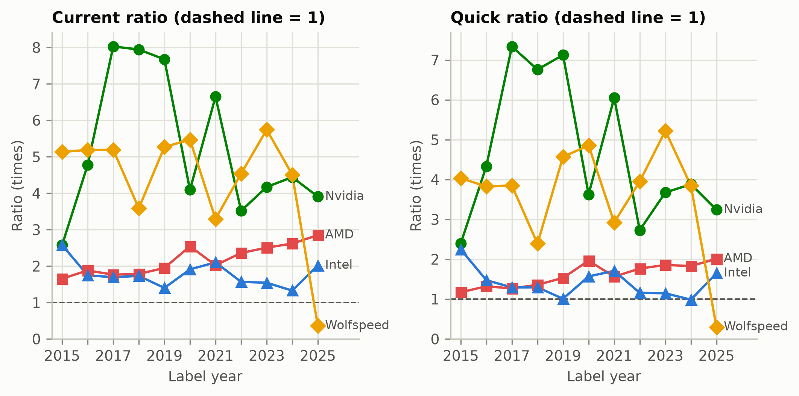

**Figure 4. Current ratio and quick ratio, with a reference line at 1.** All four companies kept a current ratio above 1 until Wolfspeed fell to 0.36 in 2025; Wolfspeed's current ratio was still 4.51 in 2024, so liquidity gave no early warning.

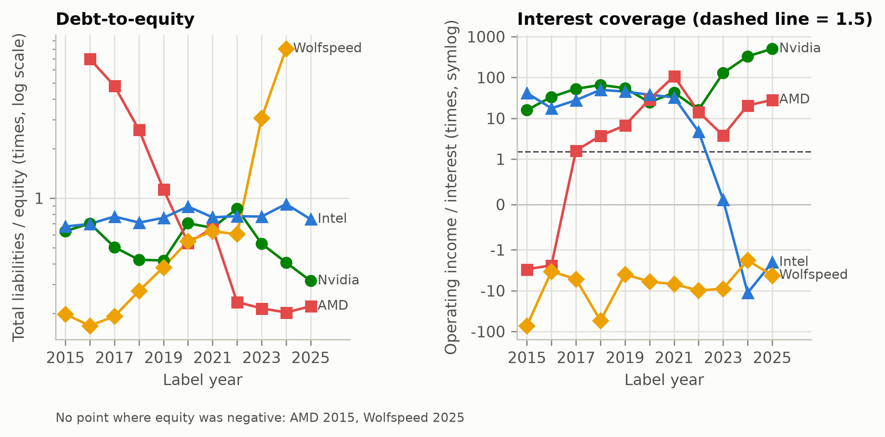

**Figure 5. Debt-to-equity (log scale) and interest coverage (symmetric log scale).** Intel's interest coverage fell from 32.6 (2021) to 4.7 (2022) and 0.11 (2023) before its 2024 loss, and Wolfspeed's debt-to-equity rose from 0.61 (2022) to 8.05 (2024). Blank points mark negative equity (AMD 2015, Wolfspeed 2025).

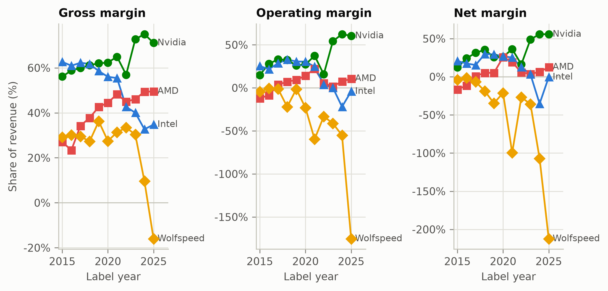

**Figure 6. Gross, operating and net margin.** Nvidia's operating margin rose from 15% to 62% (2024); Intel's gross margin fell from 63% to 33% (2024); Wolfspeed's gross margin turned negative in 2025 (−16%).

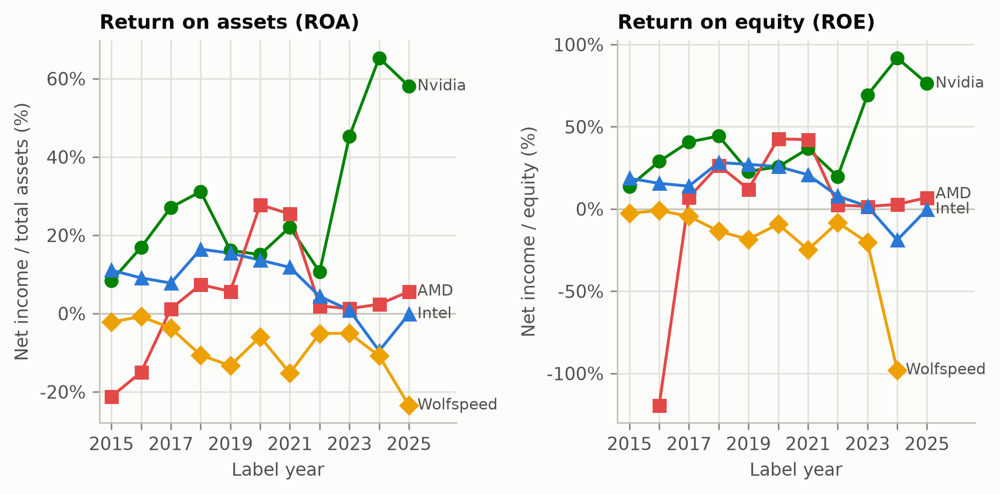

**Figure 7. Return on assets and return on equity.** Nvidia's ROE reached 92% (2024); AMD's ROA fell from 25% (2021) to 2% (2022) as its total assets rose with the Xilinx acquisition.

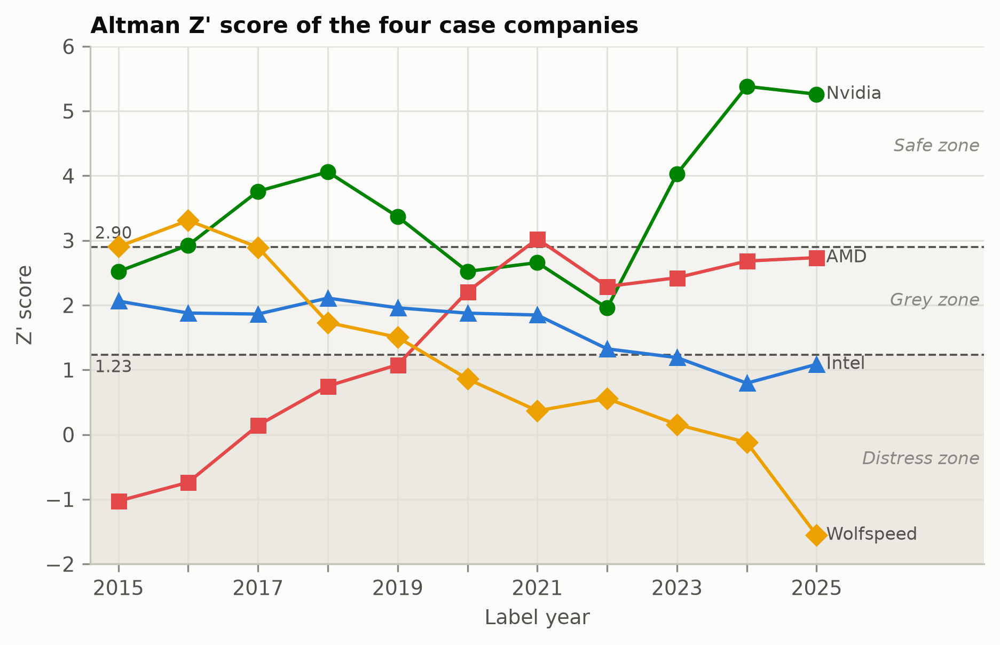

**Figure 8. Altman Z' score with the distress (1.23) and safe (2.90) cutoffs.** Wolfspeed entered the distress zone in 2020 and Intel in 2023; AMD left it after 2019; Nvidia never fell below 1.23 but was in the grey zone in 2015 and 2020–2022.

## 6.5 Cross-company observations

**Table 6.2. First year each warning sign appeared (analysis years 2015–2025)**

| Company | Current ratio < 1 | Debt ratio > 0.6 | Interest coverage < 1.5 | Operating margin < 0 | Net loss | First Z' < 1.23 |
| --- | --- | --- | --- | --- | --- | --- |
| Nvidia | – | – | – | – | – | – |
| AMD | – | 2015 | 2015 | 2015 | 2015 | 2015 |
| Intel | – | – | 2023 | 2024 | 2024 | 2023 |
| Wolfspeed | 2025 | 2023 | 2015 | 2015 | 2015 | 2020 |

The warning levels were fixed before looking at the case results. A year of 2015 means the sign was already present in the first analysis year.

1. **Profitability and coverage weakened first, and liquidity last (Table 6.2).**
   - Wolfspeed had operating losses and coverage below 1.5 from 2015, five years before Z' fell below 1.23, and its current ratio fell below 1 only in the Chapter 11 year.
   - Intel's coverage fell below 1.5 in the same year as its Z' and before its first loss. Its liquidity and leverage never crossed the warning levels.
2. **A current ratio below 1 is rarely a false alarm here, but it misses most distress (Table 6.4).** This contradicts the common expectation that a low current ratio often gives false alarms.

   **Table 6.4. The current-ratio rule as a warning signal (one-year-ahead labels, feature years 2015–2024)**

   | Scope | Company-years | Current ratio < 1 | Of which distressed next year | False alarms | Distressed next year | Distressed with current ratio ≥ 1 |
   | --- | --- | --- | --- | --- | --- | --- |
   | Operating companies | 670 | 15 | 13 | 2 | 249 | 236 |
   | All companies | 748 | 39 | 37 | 2 | 318 | 281 |

   The rule is precise but very rare: 236 of the 249 operating company-years that became distressed still had a current ratio of 1 or more.
3. **High growth did not mean low risk (Table 6.5).**

   **Table 6.5. Revenue growth and next-year distress (operating companies)**

   | Revenue growth quarter | Company-years | Growth range | Median net margin | Distressed next year |
   | --- | --- | --- | --- | --- |
   | Q1 (lowest) | 158 | −69.7% to −6.5% | −6.7% | 46.8% |
   | Q2 | 158 | −6.5% to 6.1% | 5.5% | 31.6% |
   | Q3 | 157 | 6.2% to 23.5% | 8.3% | 31.8% |
   | Q4 (highest) | 158 | 23.7% to 206.2% | 7.3% | 34.2% |

   Only the slowest-growing quarter was clearly riskier. Nvidia combines high growth with low risk, but that is not a rule for the sector.
4. **Z' has blind spots.** Nvidia (buyback accounting) and AMD (the Xilinx asset base) show that the book-value Z' moves with capital returns and acquisitions, not only with financial health.

---

# Chapter 7. Machine learning results

## 7.1 Class balance

**Table 7.1. Class balance by feature year (one-year-ahead label)**

| Feature year | Labelled rows | Distressed next year | Share | Operating companies | Distressed | Share |
| --- | --- | --- | --- | --- | --- | --- |
| 2015 | 70 | 32 | 45.7% | 65 | 27 | 41.5% |
| 2016 | 71 | 34 | 47.9% | 67 | 30 | 44.8% |
| 2017 | 77 | 31 | 40.3% | 69 | 24 | 34.8% |
| 2018 | 77 | 35 | 45.5% | 68 | 27 | 39.7% |
| 2019 | 74 | 29 | 39.2% | 65 | 24 | 36.9% |
| 2020 | 72 | 29 | 40.3% | 63 | 20 | 31.7% |
| 2021 | 82 | 31 | 37.8% | 70 | 20 | 28.6% |
| 2022 | 76 | 29 | 38.2% | 69 | 23 | 33.3% |
| 2023 | 76 | 38 | 50.0% | 69 | 31 | 44.9% |
| 2024 | 74 | 31 | 41.9% | 65 | 23 | 35.4% |
| **All** | **749** | **319** | **42.6%** | **670** | **249** | **37.2%** |

Distress was common rather than rare, so the class imbalance was mild and class weights were sufficient. Distress was also persistent: 269 of 305 distressed company-years stayed distressed the next year, while 46 healthy company-years became distressed.

## 7.2 Model comparison

**Table 7.2. Model comparison on the test years (feature years 2023–2024, 134 company-years, 54 distressed)**

| Model | Precision | Recall | F1 | ROC-AUC | PR-AUC | Validation PR-AUC |
| --- | --- | --- | --- | --- | --- | --- |
| Random forest (chosen on validation) | 0.746 | **0.815** | **0.779** | **0.895** | **0.883** | **0.917** |
| XGBoost | 0.812 | 0.722 | 0.765 | 0.894 | 0.878 | 0.902 |
| Logistic regression | **0.826** | 0.704 | 0.760 | 0.885 | 0.844 | 0.849 |
| Decision tree | 0.796 | 0.722 | 0.757 | 0.852 | 0.756 | 0.860 |
| Baseline: current ratio < 1 | 1.000 | 0.074 | 0.138 | 0.756 | 0.715 | 0.579 |
| Baseline: persistence (Z' < 1.23 now) | 0.880 | 0.815 | 0.846 | 0.953 | 0.939 | 0.910 |

Bold marks the best of the four models.

**Table 7.3. Confusion matrices on the test years**

| Model | True positives | False positives | False negatives | True negatives |
| --- | --- | --- | --- | --- |
| Random forest | 44 | 15 | 10 | 65 |
| XGBoost | 39 | 9 | 15 | 71 |
| Logistic regression | 38 | 8 | 16 | 72 |
| Decision tree | 39 | 10 | 15 | 70 |
| Current ratio < 1 | 4 | 0 | 50 | 80 |
| Persistence | 44 | 6 | 10 | 74 |

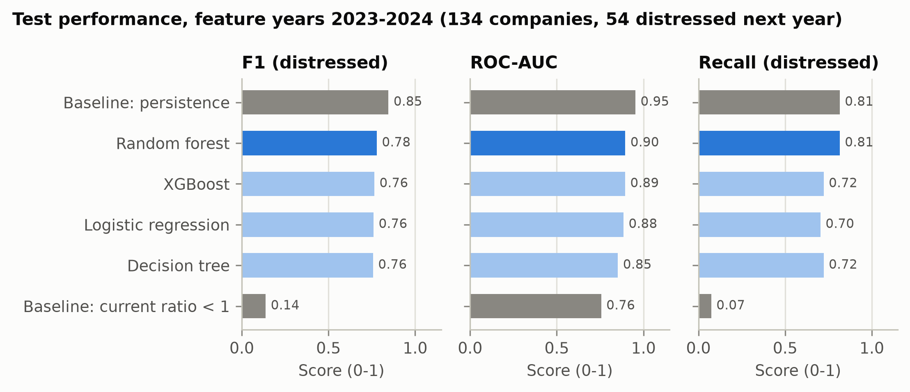

**Figure 10. Model comparison on the test years (F1, ROC-AUC and recall for the distressed class).** The random forest reached F1 0.78 and ROC-AUC 0.90, far above the current-ratio rule (F1 0.14) but below the persistence baseline (F1 0.85, ROC-AUC 0.95).

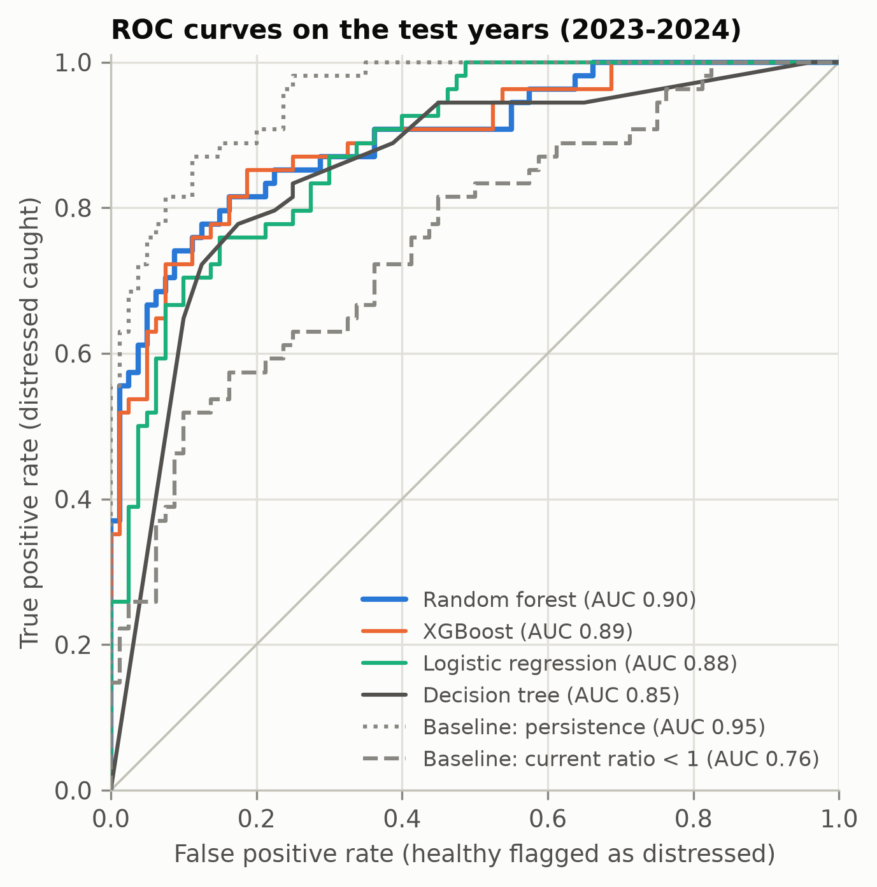

**Figure 11. ROC curves of all models and both baselines on the test years.** Random forest, XGBoost and logistic regression lie close together (AUC 0.88 to 0.90), the decision tree lower (0.85), the persistence baseline above all of them (0.95) and the current-ratio rule below (0.76).

**Interpretation.**
- **Best model, small margin.** The random forest had the highest validation PR-AUC and the highest test recall, F1, ROC-AUC and PR-AUC, but the margin over the other models was small (test F1 0.757 to 0.779). A plausible reason for its edge is that distress depends on combinations of ratios, such as weak margins together with high leverage, which tree ensembles capture without them being specified [20]. Averaging 500 trees also made it more stable than the single decision tree, whose PR-AUC fell from 0.860 on validation to 0.756 on test.
- **Persistence beat every model.** Z'-based distress is highly persistent, and the models cannot fully rebuild today's score from the ratios, since retained earnings (X2) is not a model input.
- **The current-ratio rule failed.** It flagged only 4 of 54 distressed companies.

## 7.3 Early warnings

The cases where a healthy company becomes distressed the next year are where a model can add value over persistence, which by construction flags none of them.

**Table 7.4. Early-warning cases on the test years (10 companies healthy at t and distressed at t+1)**

| Model | Flagged |
| --- | --- |
| Random forest | 3 of 10 |
| XGBoost | 3 of 10 |
| Logistic regression | 2 of 10 |
| Decision tree | 1 of 10 |
| Persistence, current ratio < 1 | 0 of 10 |

Early warnings remain the hardest cases. With only 10 such cases, each one changes recall by 10 percentage points.

## 7.4 Feature importance and leakage audit

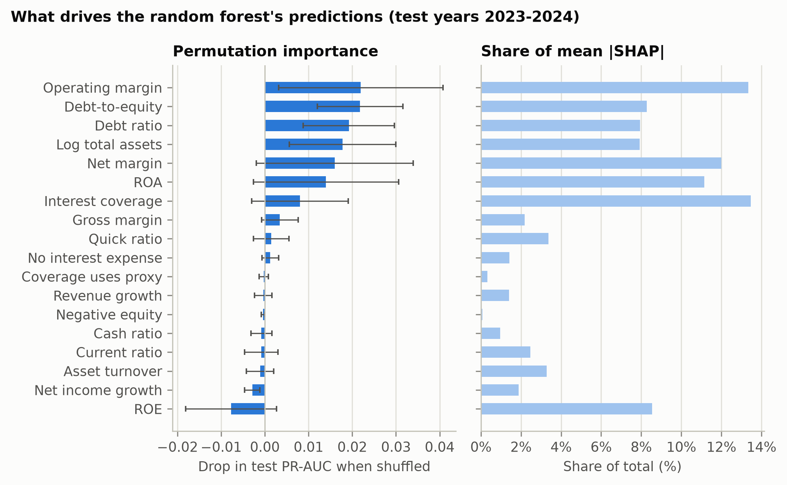

**Figure 12. Feature importance of the random forest (permutation importance and SHAP).**
- **Permutation importance** ranked operating margin, debt-to-equity, debt ratio, size (log total assets) and net margin highest.
- **SHAP** gave the largest shares to interest coverage (13.5%), operating margin (13.3%) and net margin (12.0%); the top three together account for 38.8%.
- **Uncertain order.** The error bars are wide, so the order among the top six features is uncertain.

**Leakage audit.**
- No test score was higher than the corresponding validation score for any model; for example, random forest PR-AUC was 0.917 on validation and 0.883 on test.
- No single feature dominated.
- Z' and its components were not model inputs.

There was therefore no sign of leakage.

**Logistic regression** (standardised coefficients):
- **Risk-reducing:** ROA (−1.57), operating margin (−1.51), current ratio (−1.27) and size (−0.93).
- **Risk-raising:** debt ratio (+1.41).
- **Counter-intuitive positive signs:** net margin and gross margin, most likely a result of their high correlation with operating margin and ROA (Figure 9).

## 7.5 Case-company predictions (walk-forward)

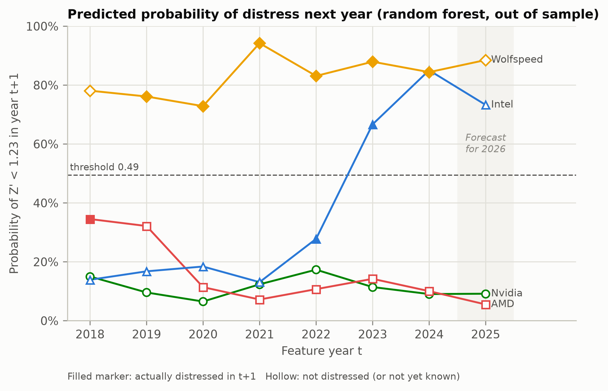

**Figure 13. Walk-forward predicted probability of distress in the following year, 2018 to 2025.** Each year is scored by a model trained only on earlier years.

- **All scored companies.** Across all 469 scored operating company-years with a known outcome (2018–2024), the walk-forward predictions reached ROC-AUC 0.922 and F1 0.800.
- **Case companies.** For the four case companies, 25 of 28 years were classified correctly (Table 6.3, Appendix D). The three errors were all at turning points: AMD 2018 and Intel 2022 were missed, and Wolfspeed 2018 was a false alarm.
- **Forecasts for 2026** (from 2025 data): Nvidia 9%, AMD 6%, Intel 73% and Wolfspeed 89%.

## 7.6 Robustness checks

- **Robustness label** (net loss, coverage below 1.5 and current ratio below 1 together). It had only 5, 4 and 2 positives in the training, validation and test years, too few to evaluate (test F1 0.15). Very few semiconductor companies meet all three conditions at once.
- **Low-revenue companies included.** On the same operating test companies, F1 was 0.778 against 0.779 without them, so the conclusion did not change.

---

# Chapter 8. Dashboard

## 8.1 Data and model

An interactive dashboard was built in Power BI Desktop [25] from CSV files exported by `src/exports.py`. The exports copy the project tables without recalculating them, and 29 consistency checks confirmed:
- unique keys, and every key present in the lookup tables
- row counts matching the data log
- values identical to the ratio table
- 81 case-company values equal to the verified 10-K figures

**Table 8.1. Dashboard data files**

| File | One row per | Use |
| --- | --- | --- |
| `dim_company`, `dim_year`, `dim_company_year` | company / label year / company-year | Company selector, year slicer, revenue-group toggle |
| `fact_ratios`, `fact_ratios_long` | company-year (and ratio) | Ratios, statement values, ROA bins, ratio selector |
| `fact_pnl` | case company-year | Profit and loss summary |
| `fact_zscore` | company-year | Z' components, score, zone, label |
| `fact_predictions` | scored company-year | Walk-forward probability, risk band |
| `model_metrics`, `feature_importance` | model / feature | Model results page |

The tables form a snowflake model:
- Company, year and revenue group are filters that pass through the company-year table to every fact table, so one slicer filters every chart.
- Predicted probabilities are shown in three bands, used consistently on every page:
  - **Low:** below 25% (green)
  - **Medium:** 25% to 49.4% (amber)
  - **High:** 49.4% and above (red). This band starts at the random forest's decision threshold, so High means "predicted distressed".

## 8.2 Pages

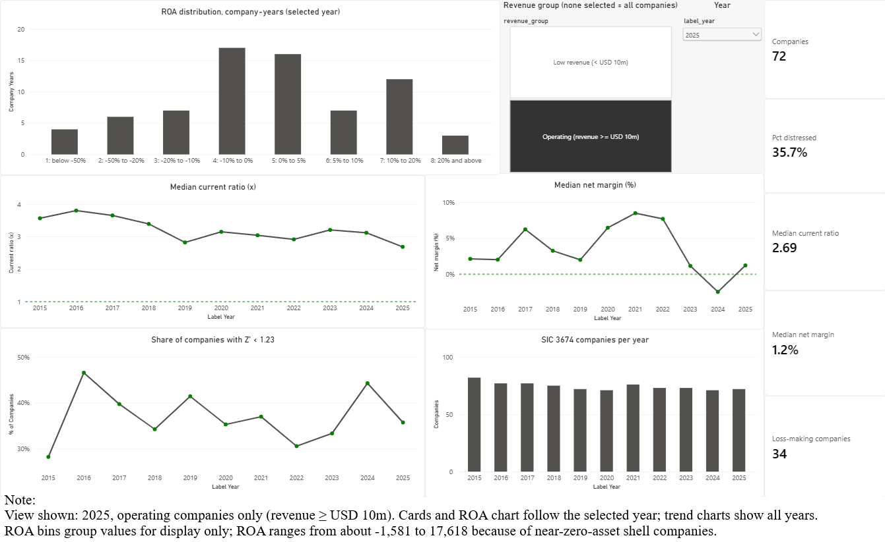

**Figure 15. Page 1, Sector overview** (2025, operating companies).
- **Cards:** number of companies, share distressed, median current ratio, median net margin and loss-making companies. They follow the selected year.
- **Trend charts:** they always show 2015–2025.
- **ROA distribution:** shown by bins for display only, because ROA has extreme values for near-zero-asset companies.

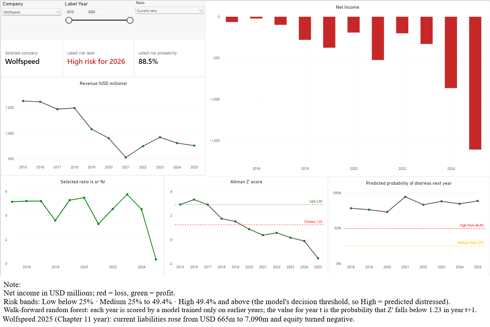

**Figure 16. Page 2, Company drill-down (Wolfspeed).**
- **Company selector:** chooses any company in the sample.
- **Cards:** the latest risk band and probability, coloured by band.
- **Charts:** revenue, net income (red for losses), a ratio of the user's choice, Z' with its cutoffs, and the predicted probability with the band thresholds.

Wolfspeed shows High risk (88.5%) for 2026.

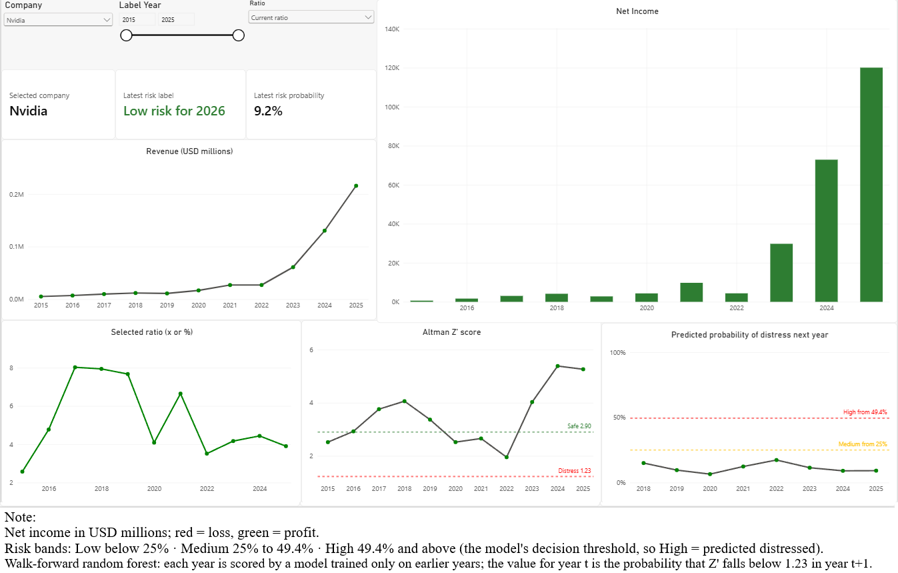

**Figure 17. Page 2, Company drill-down (Nvidia).** Low risk (9.2%) for 2026; all years profitable.

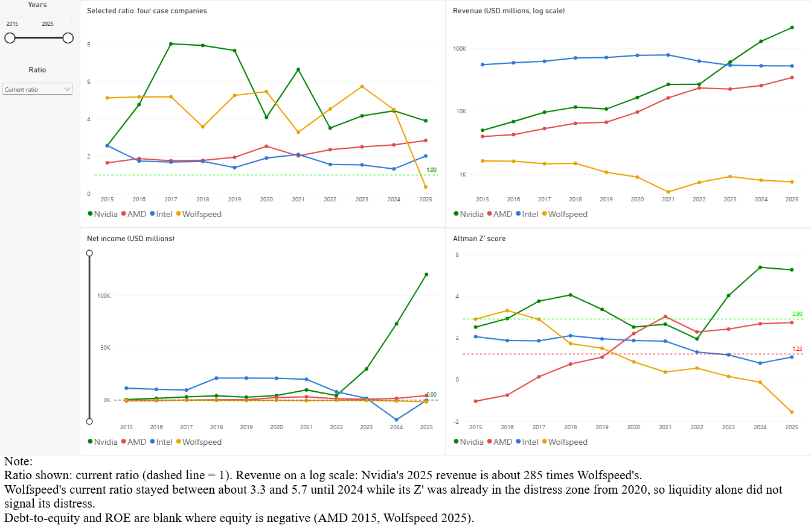

**Figure 18. Page 3, Four-case comparison.**
- **Charts:** side-by-side trends for the four case companies, with a ratio selector (here the current ratio), revenue on a log scale, net income and Z'.
- **Colours:** each company has the same colour as in Figures 2–8.

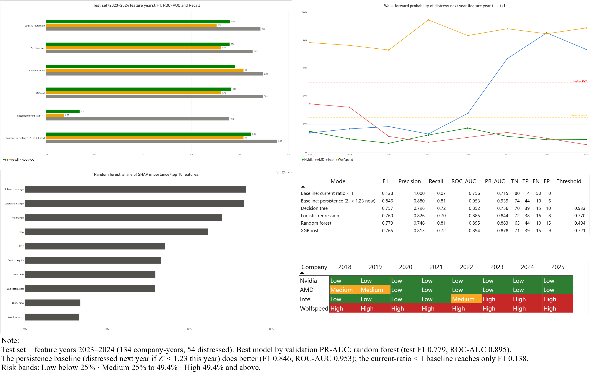

**Figure 19. Page 4, Model results.**
- **Comparison:** test-set comparison of the models and baselines, with the full metrics table.
- **Importance:** SHAP feature importance.
- **Case companies:** walk-forward probabilities and a year-by-year risk-band grid.

## 8.3 How to use it

- **Sector page:** select a year to see the state of the sector, and use the revenue-group toggle to switch between all companies and operating companies.
- **Drill-down:** select one company to check its trends and current risk.
- **Comparison and model pages:** compare the four case companies and see how reliable the model is.

Before the screenshots were taken, every card and chart was checked against the expected values exported with the data. Two errors found in that review were corrected:
- **Missing filter.** A test-set filter was missing on the model chart.
- **Swapped labels.** The Z' cutoff labels were swapped on page 2.

---

# Chapter 9. Conclusion, limitations and future scope

## 9.1 Conclusion

**Sector.** Distress was common among U.S. semiconductor filers in 2015 to 2025:
- **Distress.** Each year, 28.2% to 46.6% of operating companies had Z' below 1.23 (average 36.9%), with peaks in 2016 and 2024 and no steady trend.
- **Profitability.** It was thin and cyclical. The median net margin was best in 2021 (8.5%), negative in 2024 (−2.5%) and 1.2% in 2025, and the share of loss-making companies rose to 54.9% in 2024.
- **Liquidity.** It weakened slowly, from a median current ratio of 3.57 to 2.69.

A few large firms grew very fast, but the typical company earned little.

**Case companies.**
- **Nvidia grew.** Revenue rose about 43-fold and operating margin reached 62%, although its Z' was in the grey zone in four years for reasons unrelated to weakness.
- **AMD recovered** from negative equity to a Z' above 1.23 from 2020.
- **Intel declined.** Margins fell, capex reached 47% of revenue, and it made a loss of USD −18,756m in 2024.
- **Wolfspeed became distressed.** It lost money in every year and filed for Chapter 11 in June 2025, while its current ratio stayed above 3 until its last year.

**Algorithms.**
- **Random forest best, narrowly.** It had the highest validation PR-AUC and test F1 0.779, ROC-AUC 0.895 and PR-AUC 0.883. XGBoost, logistic regression and the decision tree followed closely (test F1 0.757–0.765).
- **Far above the current-ratio rule** (+0.641 F1).
- **Below persistence** (−0.067 F1, −0.058 ROC-AUC), because distress measured by Z' is highly persistent.
- **Value in early warning, but limited.** The models' added value lies in early warnings, where they caught at most 3 of 10 cases.
- **Out of sample.** Walk-forward predictions reached ROC-AUC 0.922.

**Answers to the research questions.**
1. Profitability, interest coverage and leverage separated healthy from distressed companies best: operating margin, net margin and interest coverage lead the SHAP shares, and operating margin, debt-to-equity and debt ratio the permutation importance. Liquidity did not, since a current ratio below 1 appeared in only 15 of 670 operating company-years.
2. Nvidia grew, AMD recovered, Intel declined and Wolfspeed became distressed. Profitability and coverage warned early (five years before Wolfspeed's Z' crossed the cutoff, one to two years before Intel's loss), while liquidity warned last or not at all.
3. The random forest predicted best but only narrowly. It is far better than a current-ratio rule, yet worse than carrying forward this year's Z', so its added complexity pays off mainly for spotting companies that are healthy now and distressed next year.

**Practical meaning.** For an analyst or investor:
- **Watch trends, not liquidity.** Follow operating margin and interest coverage rather than the current ratio.
- **Use Z' as a quick screen, with care** for heavy buyback programmes and recent acquisitions.
- **Use the model probability as a second opinion** for companies not yet distressed, as Intel's rise from 28% (2022) to 67% (2023) shows.

## 9.2 Limitations

1. **Fiscal year alignment is approximate.** 563 of 925 company-years end in December; the rest, including Nvidia (January) and Wolfspeed (June), are up to about six months out of step. The effect of this choice was not tested.
2. **Small evaluation sets.** The test years have 134 company-years, 54 distressed, and only 10 early-warning cases, so the differences between models are within what a few cases could change.
3. **Inconsistent XBRL tagging.**
   - 15.1% of values came from a fallback tag (for revenue mostly the post-2018 ASC 606 tag).
   - Total liabilities were derived for 165 company-years.
   - Interest coverage uses cash interest paid in 165 company-years.
4. **The label is a score, not an event.** The models predict Z' < 1.23, not bankruptcy.
   - Z' moves with buybacks and acquisitions.
   - Treating the grey zone as distressed would change 266 labels.
   - Its coefficients were estimated on manufacturing firms, and sources differ on the upper cutoff (2.90 or 2.99).
5. **No market information.** Book values ignore share prices and volatility.
6. **Restructuring breaks comparability.** Wolfspeed's fresh-start accounting ends its series at 2025.
7. **Narrow sample.**
   - Only U.S. 10-K filers in SIC 3674 are included; 266 foreign 20-F filings were excluded.
   - Companies with revenue below USD 10 million were not modelled.
   - The robustness label (29 positives) was too rare to model.

   Results should not be generalised to other sectors.

## 9.3 Future scope

1. Add market-based features (returns, volatility, market value), which would also allow the original Z-score.
2. Use actual bankruptcy, delisting or default events, such as Wolfspeed's Chapter 11 filing, as the label.
3. Use quarterly 10-Q data for earlier warnings, and extend the study to other sub-sectors or foreign filers.
4. Add trend features (two- or three-year changes in margins and coverage), since the direction of these ratios warned early.
5. Add text features from the management discussion and risk-factor sections of the 10-K.
6. Extend SHAP to per-company explanations, with a fairness check across company size.
7. Rerun the headline comparison with the SEC's own fiscal-year field to measure the effect of the year-alignment rule.

---

# References

1. U.S. Securities and Exchange Commission. *Financial Statement Data Sets*, quarterly files 2014 Q3 to 2026 Q3. https://www.sec.gov/data-research/sec-markets-data/financial-statement-data-sets (accessed 27 October 2026).
2. U.S. Securities and Exchange Commission. *Financial Statement Data Sets: readme* (`readme.htm` in each quarterly file).
3. U.S. Securities and Exchange Commission. *XBRL company facts API*. https://data.sec.gov/api/xbrl/companyfacts/ (accessed 27 October 2026).
4. U.S. Securities and Exchange Commission. *EDGAR filing archives*: 10-K filings of NVIDIA Corp. (CIK 1045810), Advanced Micro Devices, Inc. (CIK 2488), Intel Corp. (CIK 50863) and Cree, Inc. / Wolfspeed, Inc. (CIK 895419), fiscal years 2017 and 2024 and Wolfspeed 2025. https://www.sec.gov/Archives/edgar/data/ (accessed 27 October 2026).
5. Altman, E. I. (1968). Financial ratios, discriminant analysis and the prediction of corporate bankruptcy. *The Journal of Finance*, 23(4), 589–609. https://doi.org/10.1111/j.1540-6261.1968.tb00843.x
6. Altman, E. I. (1983). *Corporate Financial Distress: A Complete Guide to Predicting, Avoiding, and Dealing with Bankruptcy*. New York: Wiley.
7. Beaver, W. H. (1966). Financial ratios as predictors of failure. *Journal of Accounting Research*, 4 (Empirical Research in Accounting: Selected Studies), 71–111. https://doi.org/10.2307/2490171
8. Ohlson, J. A. (1980). Financial ratios and the probabilistic prediction of bankruptcy. *Journal of Accounting Research*, 18(1), 109–131. https://doi.org/10.2307/2490395
9. Standard & Poor's (2003). *Compustat North America User's Guide*, Chapter 5, "Fiscal Year-end Month of Data", pp. 118–119.
10. Financial Accounting Standards Board (2014). *Accounting Standards Update 2014-09: Revenue from Contracts with Customers (Topic 606)*; effective date amended by ASU 2015-14 (2015).
11. Calculate.co.nz. *Altman Z-Score Calculator*. https://www.calculate.co.nz/altman-z-score-calculator.php (accessed 27 October 2026).
12. Strategic CFO. *Z Score Model*. https://strategiccfo.com/z-score-model/ (accessed 27 October 2026).
13. MetricGate. *Altman Z-Score*. https://metricgate.com/docs/altman-z-score/ (accessed 27 October 2026).
14. TrueData. *Altman Z-Score Formula, Calculation and Meaning*. https://www.truedata.in/blog/altman-z-score-formula-calculation-meaning (accessed 27 October 2026).
15. Python Software Foundation. *Python 3.12*, with the pandas, NumPy, scikit-learn, matplotlib, XGBoost, SHAP, Jupyter, pyarrow and Beautiful Soup libraries.
16. 365 Financial Analyst. *Learning path* (course resource). https://learn.365financialanalyst.com/my-learning-path/
17. Kbod999. *fintech-fraud-analytics* (GitHub notebooks, course resource). https://github.com/Kbod999/fintech-fraud-analytics
18. Pedregosa, F., et al. (2011). Scikit-learn: Machine learning in Python. *Journal of Machine Learning Research*, 12, 2825–2830.
19. Chen, T., & Guestrin, C. (2016). XGBoost: A scalable tree boosting system. *Proceedings of the 22nd ACM SIGKDD International Conference on Knowledge Discovery and Data Mining*, 785–794. https://doi.org/10.1145/2939672.2939785
20. Breiman, L. (2001). Random forests. *Machine Learning*, 45(1), 5–32. https://doi.org/10.1023/A:1010933404324
21. Lundberg, S. M., & Lee, S.-I. (2017). A unified approach to interpreting model predictions. *Advances in Neural Information Processing Systems 30*.
22. scikit-learn developers. *Permutation feature importance*. https://scikit-learn.org/stable/modules/permutation_importance.html (accessed 27 October 2026).
23. Hunter, J. D. (2007). Matplotlib: A 2D graphics environment. *Computing in Science & Engineering*, 9(3), 90–95. https://doi.org/10.1109/MCSE.2007.55
24. Spearman, C. (1904). The proof and measurement of association between two things. *The American Journal of Psychology*, 15(1), 72–101. https://doi.org/10.2307/1412159
25. Microsoft. *Power BI Desktop*. https://www.microsoft.com/power-platform/products/power-bi/desktop (accessed 28 October 2026).
26. Wolfspeed, Inc. (2025). *Form 10-K for the fiscal year ended June 29, 2025*, Note 2 and Subsequent Events. SEC accession no. 0000895419-25-000110.
27. Wolfspeed, Inc. (2026). *Form 10-K for the fiscal year ended June 28, 2026*, notes on emergence from Chapter 11 and fresh-start accounting. SEC accession no. 0000895419-26-000054.
28. U.S. Securities and Exchange Commission. *EDGAR*: cash flow statements and balance sheets of the four case companies' 10-K filings for label years 2017, 2022 and 2024 (accessed 28 October 2026).
29. Soliman, M. T. (2008). The use of DuPont analysis by market participants. *The Accounting Review*, 83(3), 823–853. https://doi.org/10.2308/accr.2008.83.3.823
30. Zmijewski, M. E. (1984). Methodological issues related to the estimation of financial distress prediction models. *Journal of Accounting Research*, 22 (Supplement), 59–82. https://doi.org/10.2307/2490859
31. Shumway, T. (2001). Forecasting bankruptcy more accurately: A simple hazard model. *The Journal of Business*, 74(1), 101–124. https://doi.org/10.1086/209665
32. Barboza, F., Kimura, H., & Altman, E. (2017). Machine learning models and bankruptcy prediction. *Expert Systems with Applications*, 83, 405–417. https://doi.org/10.1016/j.eswa.2017.04.006

---

# Appendix A. Data dictionary

All money values are in USD millions; one row per company (CIK) per label year.

| Column | Source XBRL tag(s), in priority order | Notes |
| --- | --- | --- |
| `cik`, `name`, `form`, `filed`, `period` | `sub` file | Company identifier and filing details |
| `label_year` | from `period` | Compustat convention (Section 4.2) |
| `fiscal_year_end` | `period` | Original fiscal year-end date |
| `total_assets` | Assets | Balance sheet date (qtrs 0) |
| `current_assets` | AssetsCurrent | |
| `current_liabilities` | LiabilitiesCurrent | |
| `inventory` | InventoryNet | Set to 0 only for companies that never report inventory (flagged) |
| `cash` | CashAndCashEquivalentsAtCarryingValue; Cash; CashCashEquivalentsRestrictedCash… | Last fallback includes restricted cash (flagged) |
| `total_liabilities` | Liabilities | Derived where missing (flagged) |
| `equity` | StockholdersEquity | Total incl. non-controlling interests as fallback (flagged) |
| `retained_earnings` | RetainedEarningsAccumulatedDeficit | Used in Z' (X2) |
| `revenue` | Revenues; RevenueFromContractWithCustomerExcludingAssessedTax; SalesRevenueNet; … (6 tags) | Full year (qtrs 4) |
| `cost_of_revenue` | CostOfRevenue; CostOfGoodsAndServicesSold; CostOfGoodsSold | |
| `gross_profit` | GrossProfit | Revenue − cost of revenue where missing (flagged) |
| `operating_income` | OperatingIncomeLoss | |
| `interest_expense` | InterestExpense; InterestExpenseNonoperating; InterestExpenseDebt; InterestAndDebtExpense | Company facts, cash-paid proxy or zero-if-no-debt rule (`interest_source`) |
| `pretax_income` | IncomeLossFromContinuingOperationsBeforeIncomeTaxes… | |
| `income_tax` | IncomeTaxExpenseBenefit | |
| `net_income` | NetIncomeLoss; ProfitLoss | ProfitLoss fallback flagged |
| Ratios | computed | Table 4.2 |
| `z_prime`, `X1`–`X5`, `zone`, `distressed` | computed | Section 4.5 |
| `capex`, `buybacks`, `goodwill` (case companies) | PaymentsToAcquirePropertyPlantAndEquipment (Nvidia: custom PurchasesOfPropertyAndEquipmentAndIntangibleAssets, then PaymentsToAcquireProductiveAssets); PaymentsForRepurchaseOfCommonStock; Goodwill | Case study chapter only |

The tag used for every value is saved in `data/processed/tag_sources.csv`.

# Appendix B. Preprocessing log (summary)

The full, dated log is `docs/data_log.md`. Key decisions:

| Decision | Rows affected |
| --- | --- |
| Partial label years outside 2014–2025 dropped | 14 filings |
| Amended or re-filed 10-Ks: latest filing kept | 27 filings dropped |
| Non-USD filers dropped (Eteris B.V. 2014, Sono Group N.V. 2024) | 2 filings |
| Interest expense from company facts (case companies, notes only) | 17 values |
| Interest from cash interest paid (flagged proxy) | 207 values |
| Total liabilities derived | 203 rows |
| Rows missing a core item dropped (none of the case companies) | 57 rows |
| Low-revenue companies flagged (excluded from modelling only) | 117 rows |
| 10-K verification of the case companies | 99 of 99 values match |
| Capex, buybacks, goodwill verification | 32 of 32 values match |
| Wolfspeed series ended at 2025 (Chapter 11, fresh-start accounting) | — |

(Counts in this table are for all label years 2014–2025; counts in the main text are for the analysis years 2015–2025.)

# Appendix C. Code and repository

All code, notebooks, processed data and the dashboard file are in the GitHub repository https://github.com/YashPatel2777/FADS_MINI_PROJECT.

| Notebook | Phase |
| --- | --- |
| `01_data_collection.ipynb` | Download check, filing selection, case-company CIKs |
| `02_preprocessing.ipynb` | Value filter, deduplication, tag priority, derived items |
| `03_ratios_and_pnl.ipynb` | Ratios, profit and loss summary, 10-K verification |
| `04_distress_label.ipynb` | Z', one-year-ahead label, class balance |
| `05_modelling.ipynb` | Split, models, metrics, SHAP, walk-forward |
| `06_figures_and_exports.ipynb` | Figures 1–13 and dashboard exports |
| `07_case_studies.ipynb` | Case study evidence and hypothesis checks |
| `08_conclusion.ipynb` | Numbers quoted in the conclusion |

Reusable code is in `src/` (`config.py`, `load_sec.py`, `preprocess.py`, `ratios.py`, `labels.py`, `models.py`, `plots.py`, `exports.py`, `case_studies.py`, `verify.py`). The random seed is 42.

# Appendix D. Additional tables

**Table 6.1. Hypothesis check for the case companies**

| Company | Hypothesis | Evidence | Verdict |
| --- | --- | --- | --- |
| Nvidia | Revenue, margins, ROA and ROE rise sharply | Revenue 5,010 → 215,938; operating margin 15% → 62% (2024); ROE 14% → 92% (2024); dips in 2019 and 2022 | Supported |
| Nvidia | Liquidity stays strong | Current ratio 2.57–8.03 in every year | Supported |
| Nvidia | Z' stays far above 2.90 | Grey zone in 2015, 2020–2022 (low 1.96); X5 below 1, retained earnings cut by retiring bought-back shares | Contradicted |
| Nvidia | Very high ROE can reflect buybacks | DuPont 2024: 0.56 × 1.17 × 1.41 = 0.92; equity multiplier 1.31–1.86 | Partly |
| AMD | Weak profitability and thin equity early | Losses 2015–2016; equity −412 (2015); D/E 6.98 (2016) | Supported |
| AMD | Then recovery and growth | Z' above 1.23 from 2020; revenue 4,272 → 34,639; D/E 0.22 | Supported |
| AMD | Xilinx lowers ROA and asset turnover | Assets 12,419 → 67,580; goodwill 289 → 24,177; turnover 1.32 → 0.35; ROA 25% → 2% | Supported |
| Intel | Falling margins | Gross margin 63% → 33%; operating margin 25% (2021) → −22% (2024) | Supported |
| Intel | Heavy capital spending | Capex 13% (2015) → 47% of revenue (2023) | Supported |
| Intel | Rising liabilities | Liabilities 41,083 → 91,453, but debt ratio 0.40–0.47 | Partly |
| Intel | Net loss around 2024 | −18,756 (2024), −267 (2025) | Supported |
| Intel | Leverage and coverage worsen before profit collapses | Coverage 32.6 → 4.7 → 0.11 (2021–2023) before the 2024 loss; leverage gave no warning | Partly |
| Wolfspeed | Persistent losses | Net loss in all 11 years | Supported |
| Wolfspeed | High debt | Debt ratio 0.17 → 0.75 (2023) → 1.07 (2025); low until 2022 | Supported (from 2023) |
| Wolfspeed | Weak interest coverage | Negative in every year | Supported |
| Wolfspeed | Weak liquidity | Current ratio 3.29–5.74 until 2024; 0.36 in 2025 | Contradicted (until 2025) |
| Wolfspeed | Then restructuring | Chapter 11 on 30 June 2025; emerged 29 September 2025 | Supported |

**Table 6.3. Walk-forward predictions against outcomes (probability of distress in t+1; threshold 0.494)**

| Feature year | Nvidia | AMD | Intel | Wolfspeed |
| --- | --- | --- | --- | --- |
| 2018 | 0.15 correct | 0.35 missed | 0.14 correct | 0.78 false alarm |
| 2019 | 0.10 correct | 0.32 correct | 0.17 correct | 0.76 correct warning |
| 2020 | 0.07 correct | 0.11 correct | 0.18 correct | 0.73 correct warning |
| 2021 | 0.12 correct | 0.07 correct | 0.13 correct | 0.94 correct warning |
| 2022 | 0.17 correct | 0.11 correct | 0.28 missed | 0.83 correct warning |
| 2023 | 0.11 correct | 0.14 correct | 0.67 correct warning | 0.88 correct warning |
| 2024 | 0.09 correct | 0.10 correct | 0.85 correct warning | 0.84 correct warning |
| 2025 (forecast for 2026) | 0.09 | 0.06 | 0.73 | 0.89 |
